# UML — Tu Llave

Diagrama de clases del modelo de dominio. Está escrito en [Mermaid](https://mermaid.js.org/), así que GitHub y VS Code (con la vista previa de Markdown) lo dibujan directamente. Para pasarlo como imagen al documento IEEE se puede exportar desde [mermaid.live](https://mermaid.live).

**Notación**

| Símbolo        | Significado                                                          |
| -------------- | -------------------------------------------------------------------- |
| `+`            | público                                                              |
| `-`            | privado (en el código son campos `#privados` de JavaScript)          |
| `#`            | protegido                                                            |
| `*` al final   | método abstracto                                                     |
| `$` al final   | método estático                                                      |
| `<<abstract>>` | clase abstracta; `<<interface>>` es una interfaz (puerto)            |
| `<\|--`        | herencia; `<\|..` implementación de interfaz                         |
| `*--`          | composición (la parte no existe sin el todo)                         |
| `o--`          | agregación (la parte se comparte o se inyecta)                       |
| `-->`          | asociación (la clase guarda una referencia)                          |
| `..>`          | dependencia (la usa o la crea, pero no la guarda)                    |

Los getters de TypeScript aparecen como métodos sin parámetros (`saldo() number`).

## Diagrama de clases del dominio

```mermaid
classDiagram
  direction TB

  %% ---------- Núcleo ----------
  class Titular {
    +id: string
    +nombres: string
    +apellidos: string
    +documento: string
    -tarjetas: TarjetaMiLlave[]
    +Titular(datos: DatosTitular)
    +nombreCompleto() string
    +tarjetas() TarjetaMiLlave[]
    +emitirTarjeta(numero: string, saldoInicial: number) TarjetaMiLlave
    +agregarTarjeta(tarjeta: TarjetaMiLlave) void
  }

  class TarjetaMiLlave {
    +numero: string
    +titular: Titular
    -estado: EstadoTarjeta
    -saldo: number
    -movimientos: Movimiento[]
    +TarjetaMiLlave(numero: string, titular: Titular, saldoInicial: number)
    +restaurar(numero: string, titular: Titular, guardado: EstadoGuardado)$ TarjetaMiLlave
    +estado() EstadoTarjeta
    +estaActiva() boolean
    +saldo() number
    +historial() HistorialDeMovimientos
    +ultimoViaje() Viaje
    +bloquear() void
    +activar() void
    +asegurarActiva() void
    +registrarRecarga(monto: number, medioDePago: string, referencia: string, fecha: Date) Recarga
    +registrarViaje(datos: DatosViajeNuevo) Viaje
  }

  class Lector {
    +servicio: ServicioDeTransporte
    +punto: PuntoDeAcceso
    -reloj: Reloj
    +Lector(servicio: ServicioDeTransporte, punto: PuntoDeAcceso, reloj: Reloj)
    +leer(tarjeta: TarjetaMiLlave) LecturaDeTarjeta
    +validar(tarjeta: TarjetaMiLlave) Viaje
  }

  class ProcesadorDeRecargas {
    +configuracion: ConfiguracionDeRecargas
    -reloj: Reloj
    +ProcesadorDeRecargas(configuracion: ConfiguracionDeRecargas, reloj: Reloj)
    +recargar(tarjeta: TarjetaMiLlave, monto: number, medio: MedioDePago) ComprobanteDeRecarga
  }

  class Reloj {
    <<interface>>
    +ahora() Date
  }

  class RelojDelSistema {
    +ahora() Date
  }

  class RepositorioDeTitulares {
    <<interface>>
    +guardar(titular: Titular) void
    +listar() Titular[]
    +buscarTarjeta(numero: string) TarjetaMiLlave
  }

  %% ---------- Movimientos ----------
  class Movimiento {
    <<abstract>>
    +id: string
    +fecha: Date
    +monto: number
    +saldoResultante: number
    +Movimiento(datos: DatosMovimiento)
    +tipo()* TipoMovimiento
    +descripcion()* string
    +efectoEnSaldo()* number
  }

  class Recarga {
    +medioDePago: string
    +referencia: string
    +tipo() TipoMovimiento
    +descripcion() string
    +efectoEnSaldo() number
  }

  class Viaje {
    +servicio: string
    +tipoServicio: TipoServicio
    +punto: string
    +numeroTransbordo: number
    +tipo() TipoMovimiento
    +esTransbordo() boolean
    +descripcion() string
    +efectoEnSaldo() number
  }

  class HistorialDeMovimientos {
    -movimientos: Movimiento[]
    +movimientos() Movimiento[]
    +ordenadoPorFecha(sentido: string) HistorialDeMovimientos
    +filtrar(filtro: FiltroDeMovimientos) HistorialDeMovimientos
    +ultimos(cantidad: number) HistorialDeMovimientos
    +totalRecargado() number
    +totalGastado() number
    -sumar(tipo: TipoMovimiento) number
  }

  %% ---------- Pagos ----------
  class MedioDePago {
    <<abstract>>
    +tipo()* TipoMedioDePago
    +nombre()* string
    #verificar(monto: number, fecha: Date)* void
    +autorizar(monto: number, fecha: Date) AutorizacionDePago
  }

  class PuntoDeRecarga {
    +punto: string
    +tipo() TipoMedioDePago
    +nombre() string
    #verificar(monto: number) void
  }

  class PSE {
    +banco: string
    +correo: string
    +tipo() TipoMedioDePago
    +nombre() string
    #verificar() void
  }

  class TarjetaBancaria {
    -datos: DatosTarjetaBancaria
    +tipo() TipoMedioDePago
    +nombre() string
    #verificar(monto: number, fecha: Date) void
  }

  %% ---------- Transporte ----------
  class ServicioDeTransporte {
    <<abstract>>
    +nombre: string
    #tarifas: TablaDeTarifas
    +ServicioDeTransporte(nombre: string, tarifas: TablaDeTarifas)
    +tipo()* TipoServicio
    +admite(punto: PuntoDeAcceso)* boolean
    +tarifaBase() number
    #admiteTransbordoDesde(anterior: Viaje) boolean
    +calcularTarifa(contexto: ContextoDeViaje) CalculoDeTarifa
  }

  class TransMilenio {
    +tipo() TipoServicio
    +admite(punto: PuntoDeAcceso) boolean
    #admiteTransbordoDesde(anterior: Viaje) boolean
  }

  class SitpZonal {
    +tipo() TipoServicio
    +admite(punto: PuntoDeAcceso) boolean
  }

  class ServicioDual {
    +tipo() TipoServicio
    +admite(punto: PuntoDeAcceso) boolean
    #admiteTransbordoDesde(anterior: Viaje) boolean
  }

  class PuntoDeAcceso {
    <<abstract>>
    +id: string
    +nombre: string
    +PuntoDeAcceso(id: string, nombre: string)
    +tipo()* TipoPunto
  }

  class Estacion {
    +tipo() TipoPunto
  }

  class Paradero {
    +tipo() TipoPunto
  }

  class Tarifa {
    +valor: number
    +Tarifa(valor: number)
  }

  class ReglaDeTransbordo {
    +tarifa: Tarifa
    +ventanaMinutos: number
    +maximoTransbordos: number
    +ReglaDeTransbordo(config: ConfiguracionDeTransbordo)
    +numeroDeTransbordo(ultimoViaje: Viaje, nombreDelPunto: string, ahora: Date) number
  }

  class TablaDeTarifas {
    -porServicio: Map~TipoServicio, Tarifa~
    +transbordo: ReglaDeTransbordo
    +TablaDeTarifas(valores: Record~TipoServicio, number~, transbordo: ConfiguracionDeTransbordo)
    +tarifaDe(tipo: TipoServicio) Tarifa
    +establecer(tipo: TipoServicio, valor: number) void
  }

  %% ---------- Relaciones ----------
  Titular "1" *-- "0..*" TarjetaMiLlave : tarjetas
  TarjetaMiLlave "1" *-- "0..*" Movimiento : movimientos
  TarjetaMiLlave ..> HistorialDeMovimientos : crea
  HistorialDeMovimientos o-- "0..*" Movimiento

  Movimiento <|-- Recarga
  Movimiento <|-- Viaje

  MedioDePago <|-- PuntoDeRecarga
  MedioDePago <|-- PSE
  MedioDePago <|-- TarjetaBancaria

  ServicioDeTransporte <|-- TransMilenio
  ServicioDeTransporte <|-- SitpZonal
  ServicioDeTransporte <|-- ServicioDual
  ServicioDeTransporte "0..*" o-- "1" TablaDeTarifas : tarifas compartidas
  ServicioDeTransporte ..> PuntoDeAcceso : admite
  ServicioDeTransporte ..> Viaje : último viaje

  PuntoDeAcceso <|-- Estacion
  PuntoDeAcceso <|-- Paradero

  TablaDeTarifas "1" *-- "1..*" Tarifa : por servicio
  TablaDeTarifas "1" *-- "1" ReglaDeTransbordo : transbordo
  ReglaDeTransbordo "1" *-- "1" Tarifa : tarifa reducida

  Lector "0..*" --> "1" ServicioDeTransporte
  Lector "0..*" --> "1" PuntoDeAcceso
  Lector --> Reloj
  Lector ..> TarjetaMiLlave : valida y descuenta

  ProcesadorDeRecargas --> Reloj
  ProcesadorDeRecargas ..> MedioDePago : autorizar
  ProcesadorDeRecargas ..> TarjetaMiLlave : abona

  Reloj <|.. RelojDelSistema
  RepositorioDeTitulares ..> Titular
```

