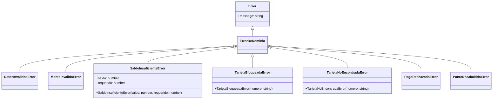
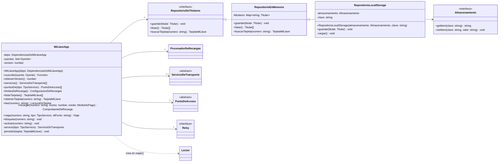
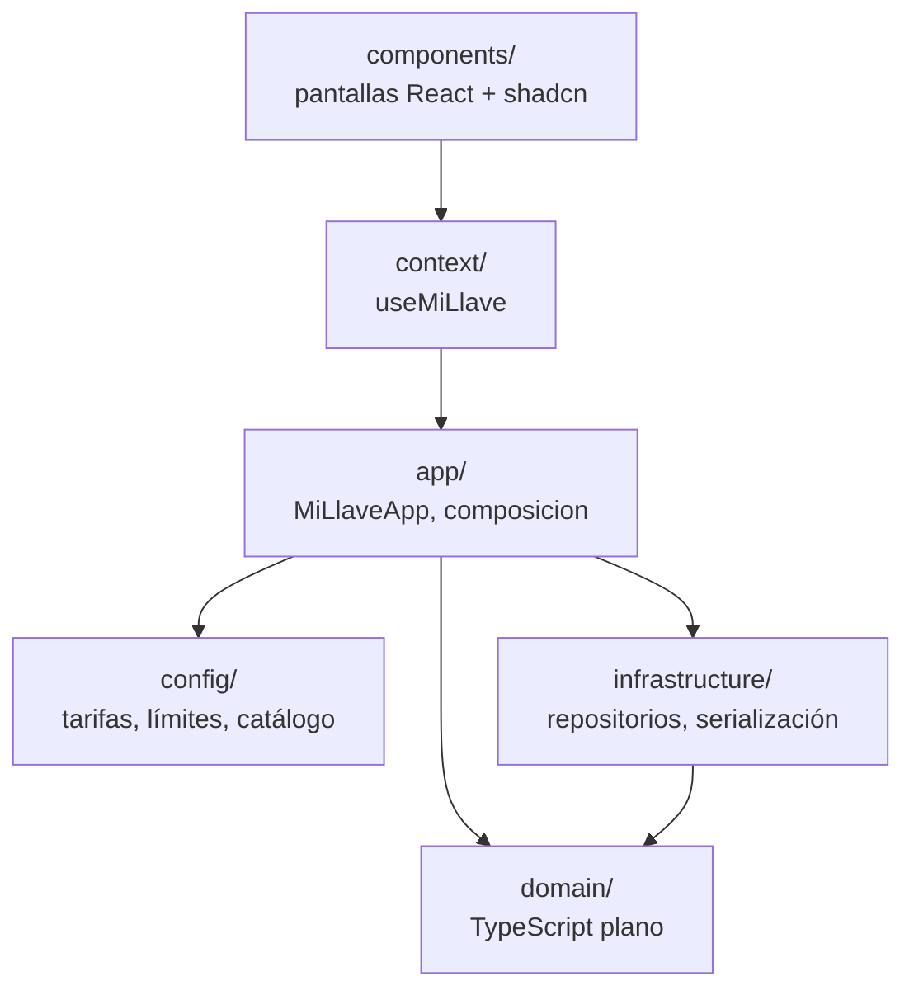
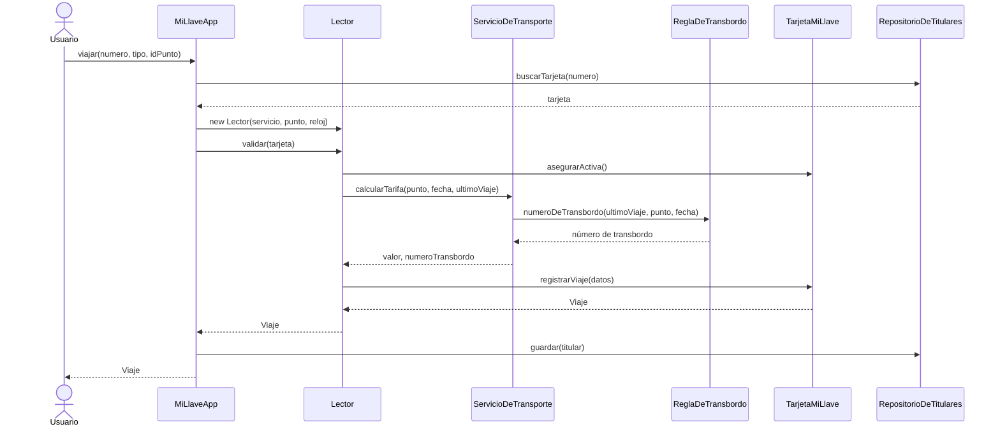
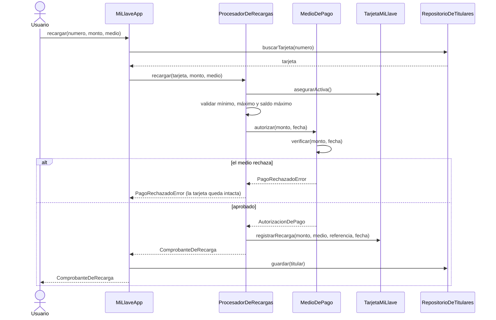

# UML — Tu Llave

Diagramas del modelo de dominio y de las capas que lo rodean. Están escritos en [Mermaid](https://mermaid.js.org/), así que GitHub y VS Code (con la vista previa de Markdown) los dibujan directamente. Para pasarlos como imagen al documento IEEE se pueden exportar desde [mermaid.live](https://mermaid.live).

**Notación**

| Símbolo        | Significado                                                          |
| -------------- | -------------------------------------------------------------------- |
| `+`            | público                                                              |
| `-`            | privado (en el código son campos `#privados` de JavaScript)          |
| `#`            | protegido                                                            |
| `*` al final   | método abstracto                                                     |
| `$` al final   | método estático                                                      |
| `<<abstract>>` | clase abstracta; `<<interface>>` es una interfaz (puerto)            |
| `<\|--`        | herencia; `<\|..` implementación de interfaz                         |
| `*--`          | composición (la parte no existe sin el todo)                         |
| `o--`          | agregación (la parte se comparte o se inyecta)                       |
| `-->`          | asociación (la clase guarda una referencia)                          |
| `..>`          | dependencia (la usa o la crea, pero no la guarda)                    |

Los getters de TypeScript aparecen como métodos sin parámetros (`saldo() number`).

## 1. Diagrama de clases del dominio

## 2. Jerarquía de excepciones

Todas las reglas de negocio violadas se lanzan como una subclase de `ErrorDeDominio`. La interfaz distingue con `instanceof` entre un error de dominio (muestra el mensaje) y uno inesperado.

| Excepción                  | Quién la lanza                                                        |
| -------------------------- | --------------------------------------------------------------------- |
| `DatosInvalidosError`      | `Titular`, `TarjetaMiLlave` (número), `Tarifa`, `TablaDeTarifas`, `MiLlaveApp` |
| `MontoInvalidoError`       | `TarjetaMiLlave`, `ProcesadorDeRecargas` (mínimo, máximo, saldo máximo) |
| `SaldoInsuficienteError`   | `TarjetaMiLlave.registrarViaje`                                       |
| `TarjetaBloqueadaError`    | `TarjetaMiLlave.asegurarActiva`                                       |
| `TarjetaNoEncontradaError` | `MiLlaveApp.obtenerTarjeta`                                           |
| `PagoRechazadoError`       | `PuntoDeRecarga`, `PSE`, `TarjetaBancaria` (en `verificar`)           |
| `PuntoNoAdmitidoError`     | constructor de `Lector`                                               |

## 3. Fachada e infraestructura

`MiLlaveApp` es lo único que la interfaz conoce. El dominio define el puerto `RepositorioDeTitulares` y la infraestructura lo implementa, así que el dominio no depende de cómo se guardan los datos.

## 4. Capas y dependencias

Las flechas indican "depende de". `domain` no depende de ninguna otra capa.

## 5. Secuencias principales

### Validar un viaje

### Recargar

